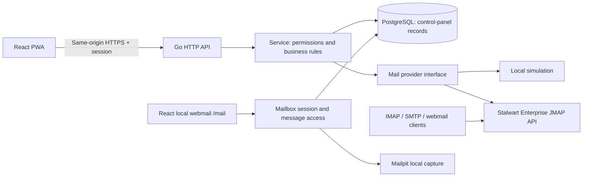

# Architecture and reading guide

## The two jobs in this system

Postharbor is the **control panel**: businesses, permissions, domain ownership,
mailbox allocation, and administrator activity. Stalwart is the **mail engine**:
SMTP queues, delivery, IMAP/JMAP access, messages, spam filtering, and disk quotas.
Postharbor's local `/mail` interface is a separate end-user sandbox: its Go routes
authenticate simulated mailbox users and read/send captured messages through
Mailpit. This is not a live Stalwart mail client.

This is a modular monolith: one frontend and one API process. It intentionally
avoids microservices, Redis, a message broker, and a complex dependency-injection
framework for a five-mailbox deployment.

## Read the code in this order

1. `frontend/index.html` declares the root element, metadata, manifest, icons, and
   the early theme script. `main.tsx` mounts React.
2. `App.tsx` restores the administrator session, loads businesses, and fetches
   tenant-scoped resources. It discards stale responses after workspace changes.
3. `pages/Workspace.tsx` renders those records. `ResourceDialogs.tsx` contains the
   forms. `components/ui.tsx` centralizes async form handling and accessible dialogs.
4. `lib/api.ts` is the administration JSON transport. `webmail/api.ts` owns the
   separate mailbox session and CSRF token. Neither stores credentials or records
   in browser storage. `webmail/Webmail.tsx` and `webmail/Compose.tsx` implement the
   end-user reader and send flow; see [WEBMAIL.md](WEBMAIL.md).
5. `backend/cmd/server/main.go` validates configuration, opens PostgreSQL, applies
   migrations, creates the first owner if needed, and starts the HTTP server.
6. `internal/httpapi/server.go` is the API route map. `auth.go` implements sessions.
   `resources.go` turns JSON payloads into service calls.
7. `internal/service/service.go` enforces ownership, input rules, and quotas.
8. `internal/store` supplies database transactions and small generic JSON scan
   helpers. `internal/mail` translates provisioning requests into JMAP calls.
9. `internal/httpapi/webmail.go` checks mailbox sessions and message access;
   `internal/webmail/mailpit.go` maps local Mailpit payloads into the UI's types.
   Migration `003_local_webmail.sql` adds simulation credential hashes, mailbox
   sessions, and per-mailbox read state.

The mail adapter uses Stalwart's [object encoding](https://stalw.art/docs/configuration/object-encoding/):
configuration lists such as credentials use numbered JSON object keys, while JMAP
method arguments such as `ids` use normal arrays. Keep this distinction when adding
features. [Account management examples](https://stalw.art/docs/auth/accounts/manage/)
are useful alongside the schema reference.

## Data ownership

`tenants` are businesses. A dashboard `user` is either the platform owner or an
administrator of exactly one business. `domains` and `mailboxes` belong to a tenant.
The platform owner can select all tenants, but still acts through a tenant-scoped URL.

Each resource lookup includes both resource ID and tenant ID. A composite foreign
key also prevents a mailbox from referring to another tenant's domain. This release
uses service authorization and SQL scoping, not PostgreSQL row-level security.
Do not describe the database itself as isolated from its trusted application role.

Stalwart gets native tenant IDs for domains and mail accounts. Its own permissions
and quotas enforce mail-client boundaries independently of the React interface.
Only the backend holds the management token; no tenant receives it.

## Follow one mailbox creation

1. React submits a local part, domain ID, display name, quota, and one-time password.
2. HTTP middleware checks origin, session, and CSRF. JSON is bounded to 16 KiB.
3. The service authorizes the business and requires a verified, provisioned domain.
4. A transaction and advisory lock check global/business mailbox counts and summed
   allocated quota. The pending mailbox is committed before any remote side effect.
5. The adapter queries Stalwart for an already-created, application-owned account.
   If absent it creates a native tenant-owned user with its disk quota and bcrypt credential.
6. On success, a second transaction stores the remote ID, marks the account active,
   and records an audit event.
7. React refreshes the list, including if a provider error left a pending record.

Allocated storage is the sum of configured mailbox quotas. It is **not actual disk
consumption** and excludes indexes/logs/database overhead. The backend applies the
quota in Stalwart too, so IMAP clients do not bypass it.

## Failure and retry rules

A database and a mail engine cannot share one atomic transaction. Therefore:

- The local resource is reserved first and remains pending after provider failure.
- Stable markers identify application-owned remote objects. Retries cannot adopt
  unrelated accounts merely because the email address matches.
- Passwords are not persisted for retries. The administrator re-enters the original
  password. If the previous request actually succeeded, retry keeps that credential.
- Explicit password resets are separate from provisioning retries.
- Deletion marks the mailbox `deleting` first. If the remote request succeeds but
  the database commit fails, retrying treats remote `notFound` as success.
- Locks serialize mutations across API processes. Remote calls have timeouts; this
  favors understandable correctness over high-throughput provisioning.

Changing providers on an existing database is refused, because simulated IDs are
not real Stalwart IDs. Use a separate production database and onboard domains again.

## Session lifecycle

A login creates a random opaque session token, stored only as SHA-256 in PostgreSQL.
The browser receives a HttpOnly, SameSite=Strict cookie; HTTPS origins also set
Secure. Sessions last 12 hours. A new login revokes older sessions for that dashboard
administrator. Logout and dashboard password changes revoke the stored session.

CSRF tokens are random session values returned to React and held in memory. Writes
require both the configured Origin and the token. There is no permissive CORS layer.
User role/tenant membership is loaded from the database on every authenticated request.

Local webmail uses an independent mailbox cookie and session records. A dashboard
administrator session does not grant message-reading access. Simulation retains
bcrypt mailbox credential hashes for this purpose; it does not retain plaintext
mailbox passwords. A mailbox password reset revokes its webmail sessions.

## Frontend structure and reuse

Use small shared primitives when behavior repeats: `AsyncForm`, `Field`, `Modal`,
`CopyValue`, `Badge`, `Empty`, `api`, `useTheme`, and `useInstall`. Page components
compose these rather than defining another password policy. Webmail has its own
small transport because its login/session lifecycle must remain separate from
the administrator session.

The webmail conversation workspace reuses its inline composer for new messages
and replies. File selection and photo previews remain local to the current draft
until send succeeds. The mailbox API transports file bytes as bounded base64
payloads; the Mailpit adapter converts them into email attachments. Authenticated
preview/download endpoints keep mailbox authorization on the server.

Saved filters have mailbox-owned database records. The browser applies their
criteria to messages the API has already authorized. A filter never grants access
to another mailbox and is not an automatic mail-routing or deletion rule.
Conversation lookup uses email reply relationships and returns only authorized
retained messages. Similar subjects alone do not imply one conversation.

CSS variables own colors/surfaces for both themes. Media queries adapt layouts at
1150, 800, and 570 CSS pixels. Native dialogs supply keyboard focus trapping. All
icons have text or accessible labels. Reduced-motion preferences disable animation.
Webmail has its own responsive breakpoints: mobile conversations and composition
occupy the viewport while hiding the surrounding header/list; desktop keeps the
conversation or compose editor in the right-hand pane.

In `frontend/src/webmail`, `Compose.tsx` handles file selection and submission,
`Conversation.tsx` presents authorized email cards and attachment previews,
`Filters.tsx` handles saved-view controls, and `presentation.ts` centralizes
formatting and filter matching. The main mailbox screen coordinates their state
and navigation rather than duplicating transport or validation helpers.

## Extending without making a mess

For a new feature, add a migration if needed, add the business rule to `service`,
expose a thin HTTP route, document it, then compose a React screen from existing
components. Add a meaningful boundary test. Only introduce another service or
dependency when the current simple structure has a concrete limitation.
