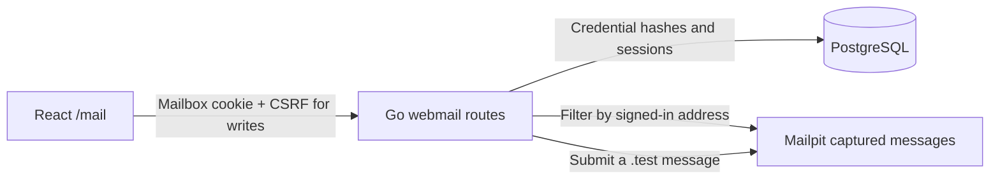

# End-user mail: the local sandbox

Postharbor now has two React interfaces on the same origin:

- `/` is the business administration dashboard for domains, mailbox accounts, and quotas.
- `/mail` is the end-user mailbox interface with Inbox, Sent, search, saved filter
  chips, email conversations, inline Compose/Reply, and file/photo attachments.

The mail interface follows the dashboard's glass surfaces, teal palette,
light/dark themes, and responsive layout. It has its own mailbox sign-in. An
administrator login is not a mailbox login.

This implementation uses **Mailpit for local capture**. It is available only in
simulation mode with `MAILPIT_URL` configured. It does not connect to live
Stalwart mailboxes, authenticate IMAP clients, or deliver messages to the internet.
Mailpit's original page at port 8025 remains available for diagnostics; end users
should use `/mail` to try the new interface.

## Start without Docker

Install the prerequisites in [NATIVE_DEVELOPMENT.md](NATIVE_DEVELOPMENT.md), then:

```sh
python3 scripts/native_demo.py
```

Open **http://localhost:8080/mail**. For React hot reload instead, stop that command,
run `python3 scripts/native_demo.py --dev`, and open **http://localhost:5173/mail**.
The native launcher supplies the Mailpit connection settings automatically.

Demo mailbox credentials:

| Mailbox | Password |
| --- | --- |
| `alex@harbor.test` | `local-mailbox-password` |
| `hello@harbor.test` | `local-mailbox-password` |

The seed step provisions these two passwords again on every seeded launch and
revokes their old webmail sessions. Restart with `--no-seed` to preserve changed
demo passwords and existing sessions. Other mailbox credentials are unaffected.
Admin credentials remain documented separately in the main README.

For an older local database, run a seeded launch once after updating the code.
The migration cannot recover a password that previous simulation versions did
not store. Seeding sets known credentials for the two named demo mailboxes; an
administrator can reset another mailbox's password through the dashboard.

## Try the complete conversation

1. Sign in at `/mail` as Alex. The generated sample conversation appears across
   **Inbox** and **Sent**.
2. Select **Compose**. The right-hand conversation pane becomes a new-message
   editor. Enter `hello@harbor.test`, a subject, and a message.
   Attach a document or photo if wanted; review selected files before sending.
3. Select **Send message**. The server submits the message to the local catcher
   and returns its ID so the UI can open the new conversation. It also appears
   in **Sent**.
4. Sign out of webmail and sign in as Hello using the second demo address.
5. Open the message in **Inbox**. Related replies appear as a chronological
   conversation with separate sent/received cards. Select **Reply**, write beneath
   the conversation, and send without opening a compose modal.
6. Sign back in as Alex to read the response. Use **Refresh messages** when needed.
7. Search the loaded folder with **Search mail**, try the filter chips, switch
   themes, and try narrow browser widths. Open the original seeded message to
   download `demo-note.txt`, and open the photo you attached in the new message.

The UI accepts up to ten comma-separated `.test` recipients per message. You can send to a
fictional address such as `customer@outside.test`; Mailpit captures it even when
no matching Postharbor mailbox exists. To sign in and receive as that address in
`/mail`, first create its simulated domain and mailbox in the admin dashboard.

## Files and photos

Compose and Reply accept multiple file attachments, including photos. You can
review names/sizes and remove a selected file before sending. The local limit is
**10 attachments and 5 MiB total decoded file data per message**. You may send
attachments without a text body. Files are sent as standard email attachments;
they are not uploaded to a separate public file-sharing service.

Raster images supported by the preview endpoint are JPEG, PNG, GIF, and WebP.
The server checks the downloaded bytes and authorizes the message/MIME part
before allowing an inline preview. Other formats remain downloadable files.
SVG, HTML, and other active documents are not embedded in the reader.

Failed sends preserve the draft and selected files for retry. Unsaved files and
draft text stay in browser memory; a page reload or closed tab loses them.

## Saved filters above the message list

Use **All**, **Unread**, or **Attachments** for common views. Create a named saved
filter to reuse a combination of sender, recipient, subject, unread state, and
attachment requirements. Each saved filter appears as a choice chip above the
message list and can be edited or deleted.

One chip is active at a time. Select a saved chip, then use its edit control to
change or delete it; the plus control creates another filter.
Text criteria match case-insensitively. From/To search the displayed names and
addresses; To does not search hidden Cc/Bcc data. Criteria within one saved filter combine
with **AND**: for example, sender `hello@harbor.test` plus attachments means mail
from that sender that also has an attachment. Empty fields and unchecked flags
do not restrict results. Search further narrows the current view.

Filters are saved in PostgreSQL for the signed-in mailbox and survive logout or
restart. Other mailboxes cannot read or edit them. A mailbox can save up to 20
filters, each with a name up to 40 characters and text criteria up to 200 characters.
These are views of the loaded Inbox/Sent messages. They do not move, delete,
forward, or label incoming email automatically.

## Conversation layout and mobile navigation

The conversation pane keeps the email subject and real sender/recipient headers
visible while displaying related sent/received messages as chat cards. A new
compose replaces this pane; a reply editor sits within the existing conversation.
The display style does not turn email into an instant-messaging protocol.
Threads follow actual email reply headers within the retained captures, not just
matching subjects. A conversation shows at most its newest 50 related messages,
oldest first within that set; a truncation notice identifies omitted history.
Very long message text is capped at 100 kB per body with a truncation marker.

On a narrow mobile screen, opening a conversation or Compose fills the viewport.
The main app header, folder navigation, and message list are hidden while that
view is open. Use its Back control to return to the list. Draft-loss confirmation
protects switching away from unsent text or attachments.

## Configuration

| Environment | Setting |
| --- | --- |
| Provider mode | `MAIL_PROVIDER=simulation` |
| Native Go process talking to native/local Mailpit | `MAILPIT_URL=http://127.0.0.1:8025` |
| Go inside the Docker demo network | `MAILPIT_URL=http://mailpit:8025` |
| Public/live deployment | Leave `MAILPIT_URL` unset; the local webmail API is disabled in live mode |

`scripts/native_demo.py` configures the native value. The optional Docker helper
`scripts/local_demo.py` loads `compose.demo.yml` for the container value. To resume
the Docker demo manually with webmail enabled:

```sh
docker compose -f compose.yml -f compose.demo.yml --profile demo up -d --wait
```

Manual Go runs read environment variables, not `.env`. Start Mailpit and set the
variables above before launching Go. Browser requests always go through the Go
API on the application origin; React never receives a Mailpit management URL or
directly calls its capture API.

## How the pieces fit



`frontend/src/main.tsx` selects the mail interface for `/mail`. The
`frontend/src/webmail` directory contains its small API client, types, main
mailbox screen, composer, styles, and tests. The separate API client keeps mailbox
CSRF/session handling independent from administrator state.

Go checks the mailbox session and address on every message/attachment request.
The browser cannot obtain a message by guessing another message ID. A send
request never chooses its own sender: the server uses the authenticated mailbox.
Replies authorize the referenced original message before using its reply header.
Read state belongs to the Postharbor mailbox, rather than changing Mailpit's
shared read marker for everyone.
Conversation lookup authorizes each returned message; a reply header never grants
access to another mailbox's captures. Saved-filter queries and mutations use the
authenticated mailbox ID, never a mailbox ID supplied by the browser.

Simulation mailbox passwords are bcrypt hashes. Session tokens are opaque and
hashed in the database; cookies are HttpOnly. Writes require the configured
Origin and mailbox CSRF token. Password resets revoke mailbox sessions. The
existing administrator cookie is separate and does not authenticate webmail.
Mailbox sessions expire after 12 hours. A new login revokes previous sessions
for that mailbox, so sign in again if a second browser invalidates your session.

Messages and drafts are not stored in browser localStorage or the PWA cache.
Formatted bodies pass an attribute-free HTML allowlist on the server and again
in the reader. Scripts, URLs, styles, embeds and remote images are removed.

## Current limits

- This is a **local mail sandbox**, not production webmail or an IMAP server.
  Mailpit is the source of message data and the configured demo retention is
  200 captures shared across addresses. The API reads the newest 200 captures;
  search filters that loaded folder, without older-message pagination.
- Sent reflects captured messages whose sender is the signed-in address;
  captured headers can also come from the sample script or other local tools.
  It is not proof that the authenticated user submitted every displayed message.
- The composer supports up to ten recipients, a subject, plain text, files, and photos.
  It supports basic rich-text formatting; CC/BCC composition is not implemented.
- Subjects are limited to 200 UTF-8 bytes, bodies to 7,000 UTF-8 bytes, and an
  upstream response or downloaded attachment to 8 MiB. Send requests have an
  8 MiB JSON limit to allow base64 encoding of up to 5 MiB of attachment data.
  Other JSON endpoints retain their smaller request limit. These are local-demo limits.
- Drafts remain only in memory. Closing a dirty composer asks for confirmation,
  but reloading or closing the browser loses the draft. Sending is online-only.
- No message deletion, labels, spam controls, automatic filter actions, forwarding, scheduled send, live
  server quotas, or public-delivery status is implemented in this interface.
- Mailpit at port 8025 is an unauthenticated local diagnostic tool with access to
  **all captures**. Keep it on loopback; it is not the user-facing privacy boundary.
  Captures are diagnostic data separate from Postharbor mailbox records.
- Deleting a simulated mailbox does not purge Mailpit captures. Recreating the
  same address can expose retained messages to that new account because local
  visibility is based on the captured address. Clear the relevant diagnostic
  captures in Mailpit before reusing a test address for a different person.

Before building live webmail, add a real per-user Stalwart/JMAP adapter, validate
its authorization and delivery behavior, and complete the live tests in
[DEPLOYMENT.md](DEPLOYMENT.md). Do not enable the local catcher for public users.

See [API.md](API.md#local-webmail-api) for request payloads and
[TESTING.md](TESTING.md) for the manual acceptance flow.

## Automated local conversation check

While the demo is running, exercise the mailbox API against real local captures:

```sh
python3 scripts/check_webmail.py
```

For a Vite origin, use
`BASE_URL=http://localhost:5173 python3 scripts/check_webmail.py`. The check signs
in as Alex and Hello, sends document/photo attachments, checks Sent/Inbox/read
state, verifies downloaded bytes and an image preview, and sends a reply. It also
checks the related conversation and creates/edits/deletes its own temporary saved
filter without changing existing filters. Finally it signs out.
It adds two captures and revokes the demo mailbox sessions, so
sign in again afterward. The native launcher's `--check` flow also runs this
check after seeding. Consult [VERIFICATION.md](VERIFICATION.md) for checks actually
completed on the current implementation.

## Contacts, groups, and organization

Open **Contacts** in the sidebar to save a name and email, edit or remove contacts,
select several people, and compose to them. Select 1–10 contacts and name a group
with **Create group**. Groups can compose directly or appear as `Group: Name`
suggestions in the new-message **To** field. Selecting a suggestion expands the
members into email addresses; duplicate recipients are removed. Groups refer to
contacts, so editing an address updates future group messages. **Use selected**
replaces a group's membership. Removing a contact removes it from groups too.
Limits: 500 contacts and 50 groups per mailbox. Local sending still requires `.test`
recipients; saved real addresses do not enable public delivery.

Open a message and use its star or **Archive** action. Sidebar **Starred** and
**Archive** views show matching messages across Inbox/Sent. Archive hides a message
from Inbox without deleting it; **Unarchive** restores it. Flags apply to the
selected email, not automatically to every email in its conversation. Captures
still expire under Mailpit retention, even when starred or archived.

Replies show only the editor, cancel action, files and send controls. Their sender,
recipients, subject and reply headers are retained automatically. New messages
keep their recipient/subject fields and a compact header.

The editor offers bold, italic, underline, lists, paragraph/heading sizes, undo,
redo and emoji buttons. Paste formatted content directly or expand **Insert HTML**,
paste markup, and leave that field to insert it. Only basic formatting survives;
this is not a full HTML/CSS template editor. Subjects remain plain text. Formatted
HTML is limited to 50 KB in addition to the 7,000-byte plain-text body limit.

`RichEditor.tsx` owns editing/sanitization; `Organizer.tsx` owns address-book UI.
Migration 005 stores the organizer in PostgreSQL keyed by mailbox. GET/PUT
`/api/webmail/organizer` use the mailbox session and CSRF boundary. PUT validates
contact/group references and uses a revision to reject stale tab updates (409).
Refresh after a conflict. Contacts and drafts are not stored in browser storage.

## Compact tools, emoji, and expanded reading

Formatting starts hidden. Tap the **Formatting** icon beside the file/photo icons
for bold, italic, underline, lists, paragraph sizes, undo/redo and HTML insertion.
Select text first: the editor remembers that selection while tools are open.
Escape, the close button, or tapping outside dismisses the panel. HTML insertion
now uses an explicit **Insert formatting** button rather than inserting on blur.

The adjacent **Emoji** icon opens a searchable, categorized Unicode 17 picker:
3,944 fully-qualified sequences including skin tones, flags and combined emojis.
All categories and results are available through **Show more**; the first 120 are
rendered initially to keep scrolling responsive. This uses device emoji fonts,
not WhatsApp artwork. Older devices may show missing glyphs. Data loads from a
bundled asset only when opened, with no external runtime request. The source and
license are in `frontend/EMOJI-DATA.md` and `frontend/UNICODE-LICENSE.txt`; maintainers
can regenerate with `python3 scripts/update_emoji_data.py`, then run frontend formatting.

**Conversations**, above Inbox, combines sent and received captures, deduplicates
by capture ID and sorts newest first. It is a combined email queue: multiple
messages in one thread can each appear. Inbox and Sent remain separate views;
archived emails stay in Archive instead of the combined queue.

Use **Expand email**, beside Archive, to show the selected email across the full
viewport with generous scrolling space, safe tables and larger attached photo
previews. **Collapse email** restores the split view without losing a draft.
Reply works inside either layout. **Forward** creates a new addressed-later draft
containing the original body and subject. Attachments must be added explicitly;
the UI reminds you. Existing message-size limits remain. Remote images, styles,
scripts and active content are still removed; expansion does not reproduce
arbitrary external HTML/CSS email templates.

## Workspace layout and panel positioning

The signed-in mailbox starts at the top of the viewport. Branding and the local
sandbox label live in the sidebar; the theme toggle sits directly above Install
mail app. Mail-specific light/dark tokens increase text contrast and divider
visibility without changing the administrator dashboard.

Formatting and emoji panels render outside the scrolling composer. The shared
`popoverPosition.ts` helper chooses above/below placement and clamps the panel
to the visual viewport. Scroll, resize, content-size and mobile-keyboard viewport
changes reposition it. Long results scroll inside the panel with a sticky header;
the same positioning applies in expanded reading mode.
